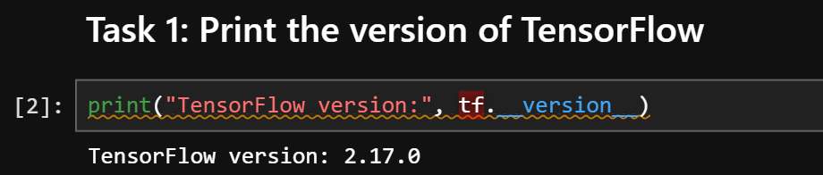
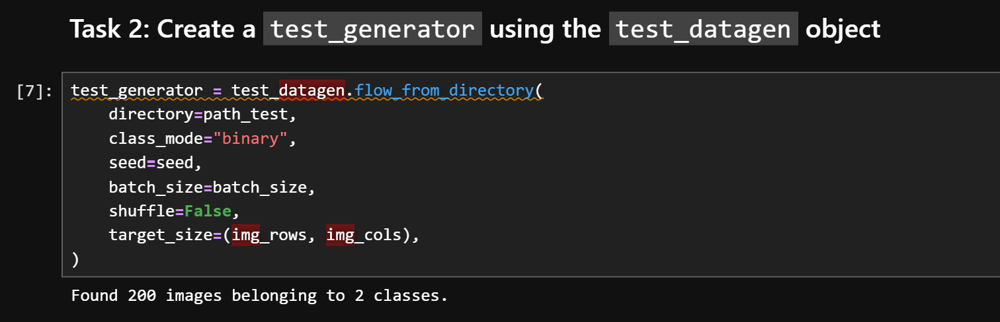
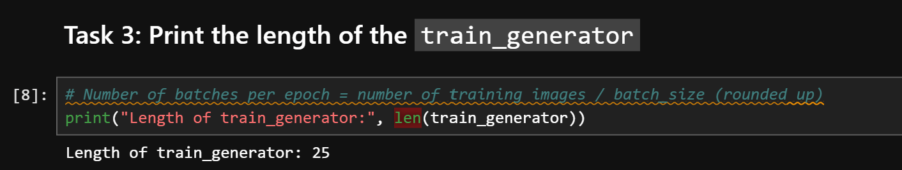
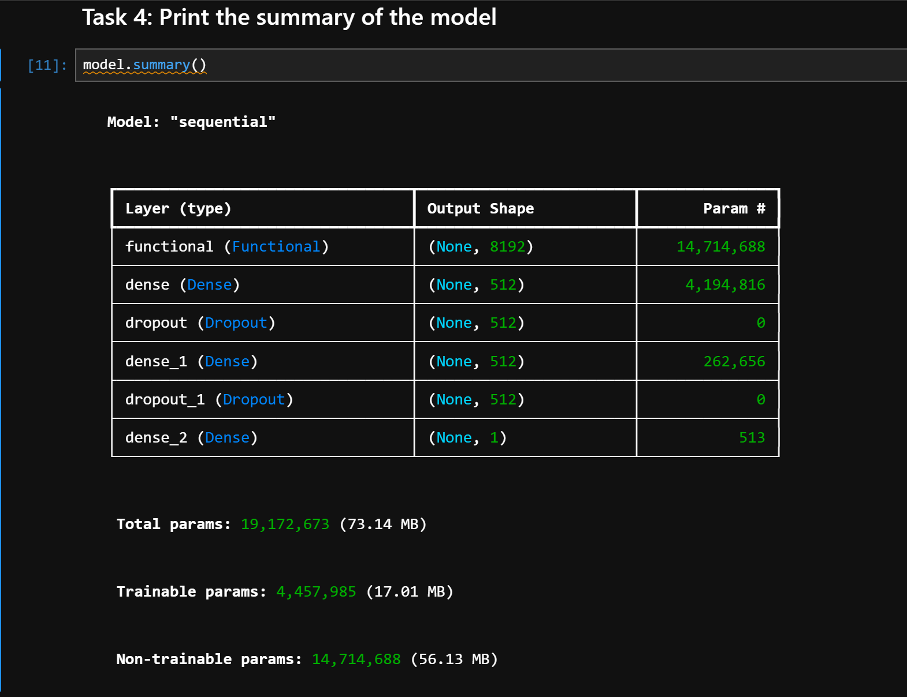
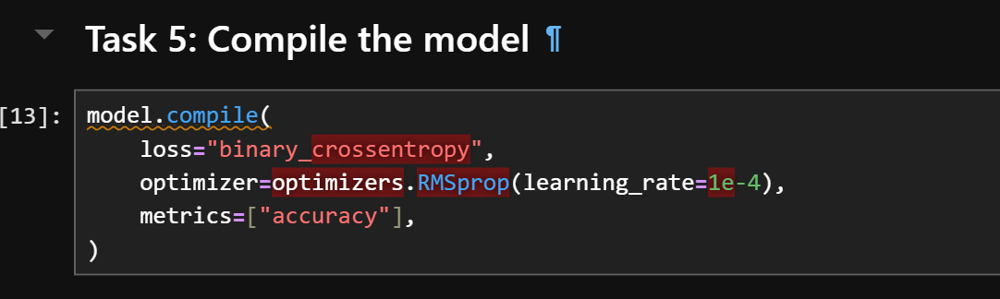
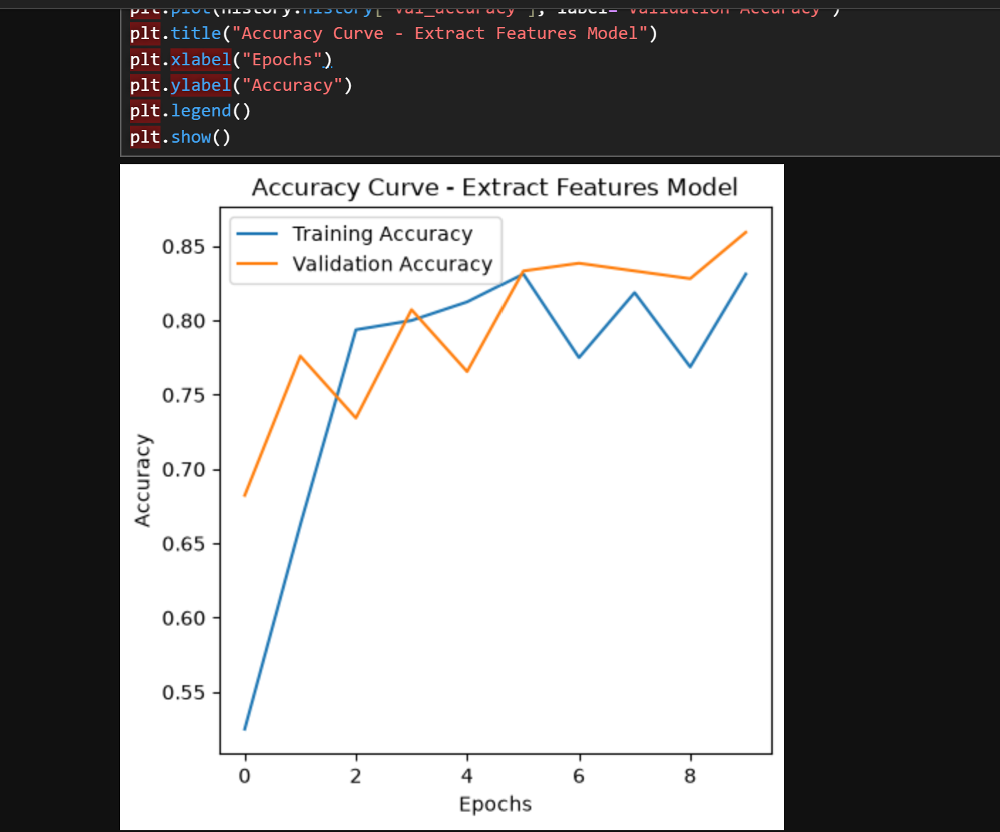
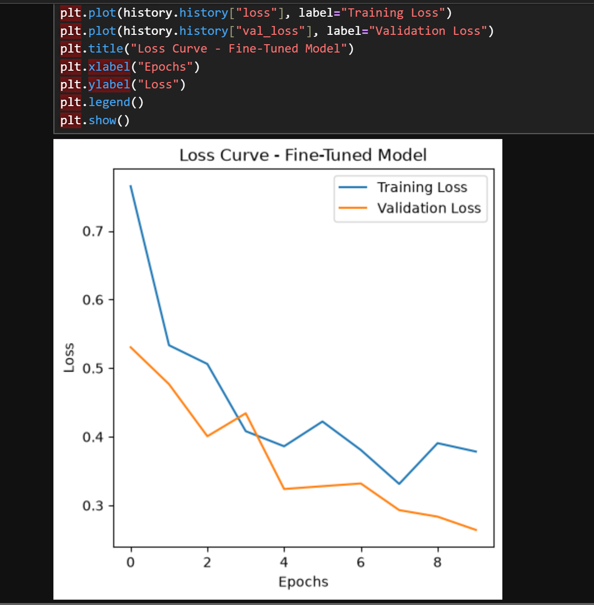
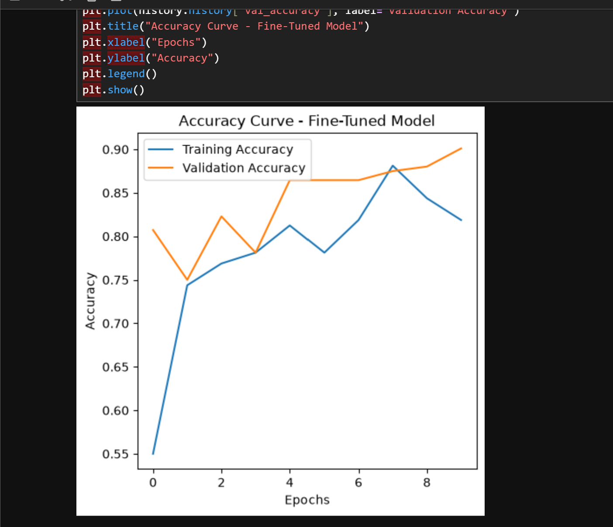
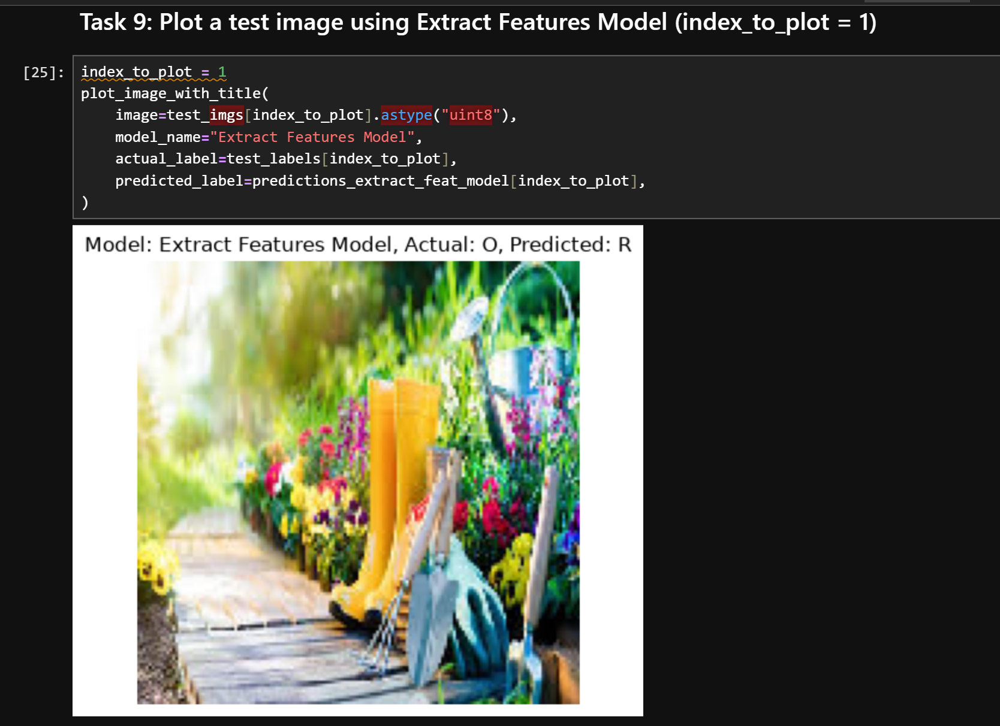
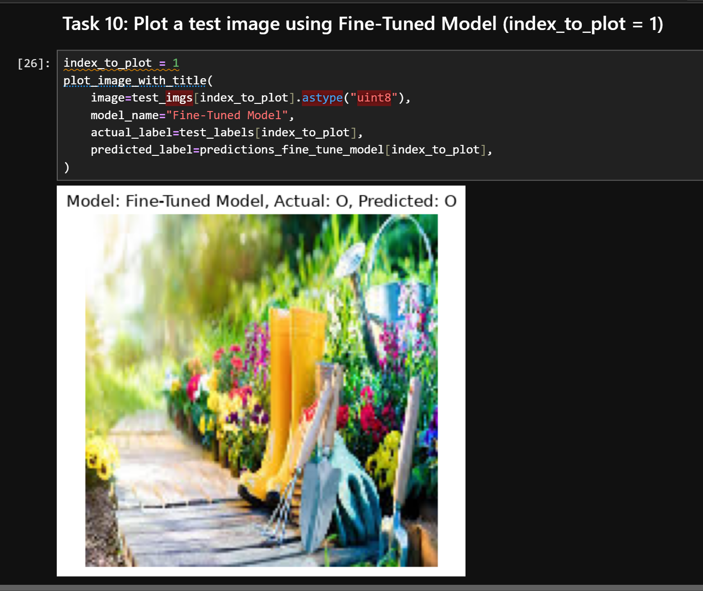

# Classify Waste Products Using Transfer Learning (VGG16)

Final project for the **Deep Learning with Keras and TensorFlow** course (IBM, Coursera).

## Problem
Sorting waste by hand is slow and error-prone. This project trains a model that looks at a photo of waste and decides whether it is:
- **O**: Organic
- **R**: Recyclable

## Approach
| Model | What is trained |
|---|---|
| Extract Features model | VGG16 (ImageNet weights) is frozen; only the new Dense layers are trained |
| Fine-Tuned model | Same, plus VGG16's last convolution layer (`block5_conv3`) is unfrozen |

- Images resized to 150 x 150, pixels scaled to 0–1
- Training augmentation: width/height shift, horizontal flip
- Top layers: Flatten → Dense(512, ReLU) → Dropout(0.3) → Dense(512, ReLU) → Dropout(0.3) → Dense(1, sigmoid)
- Loss: binary cross-entropy · Optimizer: RMSprop (lr = 1e-4, exponential decay) · Early stopping + checkpoints

## Dataset
About 1,200 images split into `train/` and `test/`, each with `O/` and `R/` folders. The notebook downloads it automatically.

## How to run
```bash
pip install -r requirements.txt
jupyter lab
```
Open `Final project.ipynb` and choose **Run → Run All Cells**.

## Results
Screenshots of every task are in the [`screenshots/`](screenshots) folder.

| Task | Screenshot |
|---|---|
| 1. TensorFlow version |  |
| 2. test_generator |  |
| 3. Length of train_generator |  |
| 4. Model summary |  |
| 5. Compile model |  |
| 6. Accuracy – extract features |  |
| 7. Loss – fine-tuned |  |
| 8. Accuracy – fine-tuned |  |
| 9. Test image – extract features |  |
| 10. Test image – fine-tuned |  |

## Tools
Python · TensorFlow / Keras · NumPy · Matplotlib · scikit-learn · JupyterLab

## Author
Saleh Khaled Saleh Alzhrani
